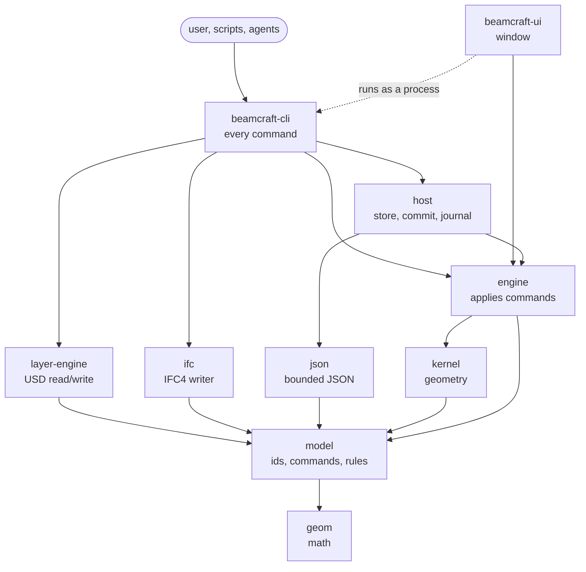
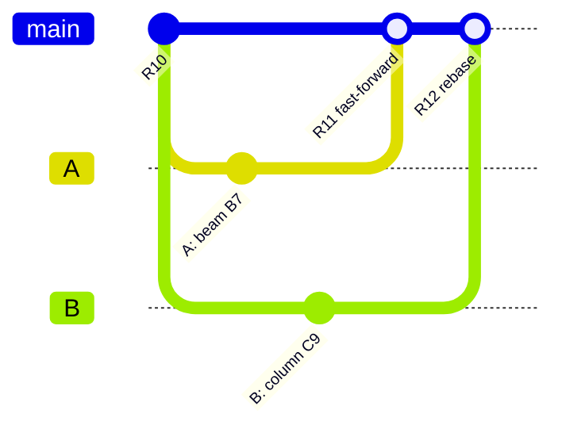

# Architecture

Four parts: how the application is built, how a project is stored on disk, how the prims inside
its USD layers are named and structured, and how several engineers work on one project. What each task delivered is
in its note under [`design/`](design/); the plan is in [`plan/`](plan/README.md).

# Part 1. The application

## Principles

- **USD is the model.** There is no second saved format. Everything the user authored and
  everything the program computed lives in USD layers; in-memory indexes and snapshots are derived
  from them and thrown away.
- **Headless first.** Every feature is an engine API, then a CLI command, then an end-to-end test.
  The window is a client of the same commands; it holds no engineering logic.
- **Own engineering core.** Geometry (extrusion, cuts, holes, volumes) and every engineering rule
  are our own Rust code. USD parsing uses the pure-Rust `openusd` crate behind our wrapper.
- **Never crash on input.** Files, arguments and keystrokes are untrusted; every input is bounded
  and refused with a stable error code instead of a panic.
- **Units:** millimetres and radians, right-handed, Z up. Conversion happens only at the edges.

## Layers of code

Dependencies point one way, down the table. `beamcraft-boundaries` checks this in CI.

| Layer | Crate | What it does |
|-------|-------|--------------|
| 0 | `geom` | Points, vectors, planes, rigid transforms, tolerances, canonical f64 encoding |
| 1 | `model` | Identities (UUIDv7, SHA-256), commands and their validation, definitions, section families, error codes, limits |
| 2 | `kernel` | Geometry kernel: plate and member bodies, profile extrusion, plane cuts, through holes, meshes, exact volumes and measurements |
| 2 | `layer-engine` | Our wrapper over `openusd`: reads and writes the project's USD layers, the schema, validation and the UUID index |
| 2 | `json` | Bounded JSON of the CLI output, read back by the UI and the coordinator |
| 2 | `ifc` | IFC4 STEP writer and GlobalId encoding; no file system |
| 3 | `engine` | Applies commands: builds the new authored state, asks the kernel for bodies, computes quantities, footprints, numbering, picking and the view snapshot |
| 4 | `host` | Disk: content-addressed blobs, atomic revision commit, journal and recovery, workspaces' storage, coordinator, compaction |
| 5 | `beamcraft-cli` (binary `beamcraft`) | Every user command; ties the crates together |
| 5 | `beamcraft-ui` (binary `beamcraft-ui`) | Native window: viewport, tools, properties panel |

`geom`, `model` and `kernel` are pure: no file system, OS or runtime, and they build for WASM. The
rest is desktop-native.



Arrows point from a crate to what it uses.
Some direct edges to `model` and `geom` are left out for readability; the exact table is in the
[module boundaries](contracts/f08-module-boundaries-v0.1.md).

## What happens on a command

Every editing command (`create-plate`, `create-member`, `update-element`, `copy-element`,
`delete-element`, `create-bolt`, `approve-numbering`, ...) follows the same path:

1. **Parse and validate.** The CLI turns arguments into a typed `model` command. Bad numbers,
   limits, identities and references are refused here with an error code; nothing is read yet.
2. **Open the head.** `host` finds the current revision and its manifest, verifies every layer
   blob by SHA-256, and `layer-engine` reads the authored layer into a model.
3. **Replay check.** Each command carries an `op_id`. If the journal already holds the same
   `op_id` with the same content, the earlier result is returned; with other content it is
   refused (`OP_ID_REUSE`). A retried command is therefore safe.
4. **Apply in memory.** `engine` builds the new authored state and asks `kernel` for the bodies of
   the elements it touches. Volumes, masses and their signatures are computed. The command also
   declares its **footprint**: what it reads and writes, element by element.
5. **Write layers.** `layer-engine` renders the new `authored.usda` and `derived.usda`; it checks
   that what it wrote matches the footprint.
6. **Commit.** `host` stores the new layers as blobs, writes an intent to the journal, writes the
   manifest and switches the head with one atomic, non-replacing file operation that also checks
   the expected base revision. Then the outcome goes to the journal.
7. **Verify.** The new revision is read back; the kernel re-evaluates every element and compares
   the stored meshes. A revision that does not verify is never the head.

A crash at any step leaves either the old or the new complete revision; `recover-revision` closes
an interrupted commit. Read commands (`inspect-elements`, `definitions`, `preview-numbering`,
`export-ifc`, `export-bom`, `pick`, `export-view`, ...) do steps 1–2 only.

## The window

`beamcraft-ui` does not open USD. It starts `beamcraft export-view` as a separate process, receives
a bundle (element-local meshes, placements, bounds, ids), re-validates it, and draws each distinct
mesh once with one instance per element. Since the issue 26 follow-up one refresh is one process
and one verified inspection: `--with-definitions true` frames the store's definitions of that
inspection before the bundle, the window keeps the scene's summary instead of its expanded display
buffers and reuses the meshes the device already holds, and a click runs the engine's pick in this
process on the snapshot on screen, reading the element's details from one
`inspect-elements --element ID` ([issue 26
follow-up](design/issue-26-viewport-performance.md)). Create, move, copy, delete, property edits,
undo and publish run the same CLI commands a user would type; the window shows the result or the
engine's refusal as it is.

## Geometry

The kernel builds closed triangle meshes:

- **Plate:** a simple counter-clockwise contour in its local plane `z = 0`, extruded by its
  thickness.
- **Member:** a section profile (rectangle, nine rolled families or a custom outline with cavities)
  extruded along the axis from start to end point, oriented by a fixed frame rule and an optional
  roll.
- **Operations:** through holes in plates (round holes as regular polygons), one plane cut per
  element. Volumes come from certified meshes or exact formulas, never guessed.

Member quantities are `section area × length × density`, with the area from the catalogue entry or
the exact formula. Every quantity has a status: `current`, `stale` (its inputs changed) or
`unknown` (for example no density); `unknown` is never shown as zero.

# Part 2. The project on disk

## The store

A project is a directory, the **store**. It is not a single `project.usda`: every file is kept
once under its SHA-256, and a revision is a list of which file plays which role.

```text
project/
  blobs/<2 hex>/<64 hex>      every file ever written, named by its SHA-256, never changed
  revisions/00000000000000000070   one small record per revision: sequence, revision id, manifest digest
  ledger/outcomes.log         journal: intent and outcome of every commit, used for replay and recovery
  maintenance.lock            held during compaction
```

The record with the highest number is the head. It names a **manifest** blob:

```text
beamcraft-revision-manifest 1
project 01a15a4d-...            ProjectId
workspace 01a15a4d-...
revision 01a15a67-...           this revision's UUID
op 01a15a67-...                 the command that produced it
sequence 70
base 01a15a67-... <manifest>    previous revision
schema f351bf3e...              schema digest
root root.usda
layers 3
layer authored authored.usda 1f8e2db8... 72014
layer derived  derived.usda  c08abe4c... 351251
layer authored root.usda     f8c94cec... 320
```

Copying the three named blobs out under their names gives an ordinary USD project that any USD
program opens. Old revisions stay in the store for undo and history until `compact-history`
removes them; identical files are stored once.

A **workspace** (personal draft) is a store of its own, forked from a published revision, with a
`workspace.json` naming its base. Edits go to the workspace; `publish-workspace` moves them to the
published store. Undo and redo add new revisions that restore earlier layers. How drafts of several
people come together is Part 4.

## The layers

Today:

```text
root.usda                   units (metersPerUnit = 0.001, upAxis = Z), ProjectId, schema digest
├─ authored.usda            what the user decided: elements, parameters, placements, relationships
├─ derived.usda             what the program computed: meshes, volumes, masses, their signatures
└─ external/<sha256>.usda   a foreign model, read-only, one file per attached source
```

`authored.usda` is stronger than `derived.usda`. `derived.usda` only adds `over` opinions under the
same element paths, so deleting it loses nothing that cannot be recomputed. A foreign model is
stored byte for byte and never written; our reference wrapper composes it below its own prim.

**Rule for splitting into layers.** A layer is a boundary of **who may write** (a discipline, a
design option, views), of **origin** (authored by a person or computed by the program) and of
**weight** (heavy geometry kept apart). The structure of the model (assembly, level, mark) is data
and relationships inside the layers and never becomes a file: it changes all the time, and one
part belongs to several groupings at once.

Planned:

```text
<code>_Coord.usda                  coordination root (see "Project organization" below)
├─ <code>[_<zone>]_<section>.usda  one authored layer per section and zone; a workspace
│                                writes only its authorized active-section scope (U19)
├─ options/<option>.usda           design options as delta layers over the base (O01–O04)
├─ derived/<element or group>.usda derived data in parts, so one edit does not rewrite all (U15),
│                                  heavy geometry as payloads loaded on demand (U10)
├─ assets/<sha256>.usda            shared geometry of instances, stored once (U11)
├─ views.usda, review.usda         saved views and review notes (W01, W02)
├─ lighting.usda                   optional lighting for USD viewers (U13)
└─ external/<sha256>.usda          foreign models, read-only
```

## Project organization and layer names

The approved foundation distinguishes a **section** (team deliverable such as `KM` or `KMD`)
from an **engineering module** (`steel`, which can serve both). The proposed rules are in
[F12](contracts/f12-project-coordination-v0.1.md) and the
[F10 0.2 amendment](contracts/f10-domain-vocabulary-v0.2.md); both are draft specifications,
not implemented capabilities. The frozen F10 0.1 workspace rules remain the old contract line.

A project is organized by section and optionally by zone (a building or block such as `K1`,
`K2`). Each section/zone has its own authored scope; the coordination root composes them.
Zones are optional. Teams may keep sections in one store or create independent projects per
section or zone, connected read-only by a coordination project. An independent section project
has its own publication history and engineers' workspaces. It is not a workspace of the
coordination project. An active section and explicit authorized zone set govern ordinary edits;
module availability, file names and section codes do not grant rights. Shared metadata and grids
require separately authorized shared commands.

**Names.** `<code>[_<zone>]_<section>.usda`, with the project code, the optional zone and the
section code. This clarifies the older `<discipline>` placeholder without changing file names.
No program version is part of a name; the format version is stored inside. A
project has layers only for the sections it contains: a concrete building without steel has no
`KM` or `KMD` layer.

| Code | Content |
|------|---------|
| `Coord` | Coordination: the root layer with the project metadata and the list of all layers |
| `Grids` | Axes and levels (axes: [grid contract draft](contracts/t01-project-grids-draft-v0.1.md)) |
| `KM`, `KMD` | Steel structures, design or detailing; written by BeamCraft |
| `KR` | Reinforced concrete |
| `AR`, `AI`, `GP` | Architecture, interiors, site plan |
| `EOM`, `VK`, `OV`, `SS`, `TH` | Electrical, water and drainage, HVAC, low-current systems, process |

Example, project `2401-DEMO` with two zones:

```text
2401-DEMO_Coord.usda             coordination: metadata, list of every layer
├─ 2401-DEMO_K1_Grids.usda       axes and levels of K1
├─ 2401-DEMO_K2_Grids.usda       axes and levels of K2
├─ 2401-DEMO_K1_KM.usda          steel of K1, written by BeamCraft
├─ 2401-DEMO_K1_KM.derived.usda  meshes and quantities computed for it
├─ 2401-DEMO_K2_KM.usda          steel of K2
├─ 2401-DEMO_K1_AR.usda          architecture of K1, read-only
└─ …
```

The same split as one project per zone: `2401-DEMO-K1_Coord.usda` and `2401-DEMO-K2_Coord.usda` are
complete projects, and a coordination project `2401-DEMO_Coord.usda` composes both read-only.

The independent-section organization works the same way. Each connection pins the source
ProjectId, exact RevisionId and manifest digest, with an explicit source scope and rigid
placement. A coordination revision might pin AR A17, KM S09 and OV M23. Publishing AR A18
leaves that revision unchanged; an explicit, verified connection update publishes a new
coordination revision. Missing sources never fall back to `latest`. Retained coordination
revisions keep their dependency resources reachable. Source-local element paths stay intact;
the coordination view identifies an element by its source project and element ID, and its
occurrence by the connection path. F12 defines the draft rules and required acceptance cases.

**Project metadata** in the coordination layer (`customLayerData`): `bim:projectId`,
`bim:projectCode` (`2401-DEMO`), `bim:projectName` (`Demo warehouse`), `bim:organization` (`ACME`) and
`bim:zones` (`["K1", "K2"]`, empty for a project without zones).

**From KM to KMD — deferred; decide after the MVP.** The following is the earlier candidate
direction for R06, to be reassessed after the MVP rather than finalized or implemented now.
Steel design (`KM`) and steel detailing (`KMD`) are a chain, not two
independent disciplines. `KM` is its own layer, made in BeamCraft or arriving read-only from
another program. Detailing starts from it: a "create KMD from KM" command carries the KM elements
into the `KMD` layer as the starting point, and each carried element gets a `bim:builtFrom`
relationship naming the KM element and the KM revision it came from. From then on `KMD` lives on
its own (connections, bolts, welds, cuts, numbering), and the KM layer is read-only in the
detailer's workspace. When KM changes, the program compares the new KM revision with the one each
KMD element was built from and marks the affected KMD elements "source changed, check"; it never
rewrites KMD by itself.

Inside the store, layers are still blobs named by their SHA-256; these names are the names the
manifest gives them and the names a checkout of a revision writes to disk.

**Status:** the code still writes `root.usda`, `authored.usda` and `derived.usda` without zones,
codes or metadata other than the ProjectId (tasks U19, U20, U21). F12 and F10 0.2 specify the
proposed responsibility and coordination boundary; their schema, commands and retention checks
must be implemented before claiming support. A second engineering module, review/approval
workflow and multi-client merge are not delivered by these documents.

## Common Craft viewing and specialized editing

### One workflow for all company arrangements

The company may author every section, author one section and receive all others as IFC, or
author several sections while referencing the rest. This is one workflow: each model is either
owned authored content or a pinned read-only reference, and the engineer edits only an
authorized section through its specialized module. Internal/external delivery changes how
assignments and responses travel, not what their versions or approvals mean. Storage in one
project or several connected projects is a separate choice (F12 PC-WORK-001).

A KM-only company can model steel against architectural IFC, and an OV-only company can model
services against structural IFC. The proposed [external-reference workflow](contracts/f12-external-reference-workflow-v0.1.md)
converts each received IFC into one logical read-only USD reference, retaining original source
bytes, IFC identifiers, conversion settings, coordinate mapping and losses. It does not create
native editable parts. New deliveries are explicitly reviewed and pinned without overwriting
the source versions on which existing work depends. A shared Craft coordination project is
optional, and external companies need no Craft application or account.

Opening requests can leave Craft as human-readable reports with exact assignment versions,
source IFC identification, dimensions and locating context. External answers are recorded with
their evidence and applicability; sending a report alone is not approval, and an old 150 mm
acceptance never approves a 200 mm successor. External implementation stays in the recipient's
authoring tool. This is a specified workflow; IFC conversion/report codecs are not implemented.

### Shared reading and module capabilities

The approved [stage 6 contract](contracts/f12-craft-read-capabilities-v0.1.md) gives Craft
applications a common read path for admitted content from all project sections. For example,
BeamCraft can inspect supplied MEP representations and properties read-only; MEPCraft supplies
MEP editing and can inspect steel read-only. An application exposes its enabled modules;
editing still requires a compatible owning module, a supported typed command and authority
over the active section/zone. Application branding grants no rights.

The common reader lists identity, provenance, relationships, declared properties and supported
representations without invoking an absent engineering module. Missing geometry remains an
explicit state; display-only meshes and unknown quantities never imply certified engineering
results. Generic property panels cannot bypass typed commands. This is a proposed common API
boundary, not an implemented cross-product viewer or a decision to duplicate the core.

## Opening assignments between sections

The approved stage 4 workflow is [specified as an F12 companion](contracts/f12-opening-assignments-v0.1.md).
The services engineer connects a pinned structural reference, models pipes/ducts without
changing the structures, collects required openings and sends an assignment file. One file
can carry many assignments, each with its own persistent identity and proposal version.
The structural engineer reviews items individually, authors accepted openings in the host
model and returns exact-version decisions and implementation evidence. File receipt,
acceptance, physical implementation and coordination update remain separate events.

If a request changes from 150 mm to 200 mm while a reviewer considers the old version, the
old acceptance remains attached to 150 mm. It neither approves 200 mm nor overwrites the new
request. A changed host revision requires revalidation. Duplicate deliveries are idempotent;
competing decisions remain explicit conflicts. Each party writes its own history, and imports
validated immutable evidence from the other, without a cross-project atomic transaction.
These are draft contract rules: no file codec, opening-assignment UI or domain module is
implemented by this documentation change.

# Part 3. Prim structure

## Prim hierarchy and naming rule

```text
/World                                   project root (defaultPrim), kind = assembly
  /Definitions
    /Materials/MAT_<sha256>              material
    /Profiles/PRF_<sha256>               profile
  /Levels/LVL_<uuid>                     level, shared by every discipline
  /References/REF_<uuid>                 foreign model, read-only
  /Steel                                 steel discipline, kind = group
    /Parts/PRT_<uuid>                    plate, beam or column, kind = component
      /Geometry                          mesh, kind = subcomponent (derived.usda)
    /Assemblies/ASM_<uuid>               assembly
    /Connections/CON_<uuid>              weld or bolt group
```

The rule:

1. **A path never changes.** It holds only what never changes for an element: its category and
   its identity. Name, assembly, level and mark change, so they are attributes and relationships.
   Moving a part to another assembly never touches its path or anything that points to it.
2. **The folder is the category, the prefix is its three-letter code.** `MAT`, `PRF`, `LVL`, `REF`,
   `PRT`, `ASM`, `CON`. The kind inside a category is an attribute: `bim:elementKind` is `plate`,
   `beam` or `column` (a beam may become a column), a connection is a weld or a bolt group.
3. **The identity is complete.** `<uuid>` is all 32 hex digits of the UUIDv7, `<sha256>` all 64 hex
   digits of a definition's content; nothing is shortened.
4. **Disciplines are second-level folders.** `/Steel` holds what belongs to steel detailing; a later
   discipline sits beside it. Definitions, levels and references are shared and stay outside.
5. **The readable name is `displayName`** (equal to `bim:name`), which USD viewers show instead of
   the prim name.
6. **Child prims have fixed names.** `Geometry` is the full body; later representations get their
   own fixed names (`Proxy`, `Axis`).
7. **Element category folders have `kind = group`.** This keeps the USD model hierarchy intact
   between the project root and its components or assemblies.

Groupings are relationships, not parents (`bim:partOf`, `bim:level`, `bim:connects`): a part
belongs to an assembly, a level and later a phase or zone at the same time, and a weld joins parts
of different assemblies, which a single tree cannot express.

**Compatibility:** U16 writes and reads only this layout. Stores written before U16 and their
schema pins are refused, with no migration (pre-alpha).

## Attributes

Two namespaces: `bim:` for anything common to building elements, `steel:` for steel detailing.
All values are explicit attributes, readable without registering a schema.

**Every element** (`authored.usda`):

| Attribute | Meaning |
|-----------|---------|
| `bim:id` | UUIDv7, the identity |
| `bim:name` | user label |
| `bim:elementKind` | `plate`, `beam`, `column`, `assembly`, `connection`, `level`, `reference` |
| `bim:schemaVersion`, `bim:geometryMode`, `bim:createdBy` | schema version, mode, creating operation |
| `xformOp:translate`, `xformOp:orient` | placement (millimetres, quaternion) |

**By kind:**

| Kind | Attributes and relationships |
|------|------------------------------|
| Plate | `steel:plate:contourPointsMm`, `steel:plate:thicknessMm`, holes `steel:plate:holePointsMm` + `steel:plate:holeVertexCounts`, `bim:material` → definition |
| Beam, column | `bim:axisPointsMm` (start, end), `steel:member:rollRad`, `bim:profile` → definition, `bim:material` → definition |
| Plate cut (plate, beam, column) | `steel:cut:pointMm`, `steel:cut:normal`; the side the normal points to is removed |
| Assembly | no body; parts point to it |
| Weld | `steel:weld:type`, `:sizeMm`, `:location`, `:side`; `bim:connects` → [main part, secondary part] |
| Bolt group | `steel:bolt:diameterMm`, `:count`, `:pitchMm`, `:originMm`, `:directionMm`; `bim:connects` → [main, secondary] |
| Level | `bim:elevationMm` |
| Reference | wrapper placement and source pin; the foreign model is composed below it, read-only |

**Relationships on a part:** `bim:partOf` → its assembly, `bim:level` → its level.

**Numbering** (after `approve-numbering`): `steel:numbering:series`, `steel:numbering:number`,
`steel:numbering:basis` on each part and assembly.

**Definitions** (`MAT_<sha256>`, `PRF_<sha256>`): `bim:definitionKind` (`material`, `i_shape`,
`channel`, `rhs`, ...), the values (`bim:densityKgM3`, `steel:profile:hMm`, `:bMm`, `:twMm`, ...),
`bim:contentDigest`. The prim name is the SHA-256 of the content, so a definition never changes;
an element pins exactly the definition it was built with.

**Derived data** (`derived.usda`, on `.../PRT_<uuid>/Geometry`): the mesh (`points`,
`faceVertexCounts`, `faceVertexIndices`, `extent`, normals), and the quantities `bim:volumeMm3`,
`bim:massKg` with `bim:volumeStatus`, `bim:massStatus`, `bim:shapeKey`, `bim:shapeSignature`,
`bim:massSignature` and `bim:quantityAlgorithm`. A signature is the hash of the inputs a value was
computed from; when the inputs change, the stored value reads as `stale`.

## What is not in the project yet

- Visual appearance: no `material:binding` or `displayColor`, so other USD viewers show grey parts.
- Payloads and instancing: every mesh is written into `derived.usda`, which is rewritten on every
  edit.
- Cuts and holes are element attributes; the contract moves them to separate operation records.

# Part 4. Collaboration

Several engineers work on one project at the same time, each building different beams and columns
in different places. All elements live in one `authored.usda`, but that does not make every edit a
conflict: a conflict is decided by **what** was changed, element by element, never by which file
or which lines changed.

## A draft per person

Each engineer works in a **workspace**: their own copy of the project, forked from a published
revision (its **base**), with its own history, undo and redo. Nobody edits the published project
directly. It works like a branch in git, but for the model.

## Publishing and merging



1. **A and B both start from R10.** Each creates a workspace; each edits only their own draft.
2. **A publishes first.** The published head is still R10, A's base, so A's draft simply becomes
   R11 (fast-forward). Nothing is merged.
3. **B publishes second.** The head is now R11, B's base is R10: B's work must be merged.
4. **Merging replays operations, never files.** B's operations, as B issued them ("create column
   C9 with these parameters"), are run again on top of R11. The engine validates them again, the
   kernel rebuilds the geometry and quantities are recomputed, so the result R12 is consistent
   with the new base. Text or layer diffs are never merged.
5. **Footprints decide whether a replay is safe.** Every command declares which elements and which
   property groups it reads and writes. B wrote {C9}; A, between R10 and R11, wrote {B7}. No
   overlap: the replay is automatic.
6. **An overlap is a conflict, shown to a person.** Both changed the same property of the same
   element; A deleted a part B welded to; A approved numbering and B then changed a profile. Both
   versions are kept and the engineer decides. There is never a silent "last writer wins".

One local coordinator (`serve-coordinator`, loopback only, token per person) holds the single
publish queue, so two publications can never overwrite each other.

## Why not a USD layer per person

USD can give each person a sublayer, but then the stronger layer's opinion simply hides the other
one: a conflicting edit disappears silently. Splitting storage into more files (per zone or per
element, task U15) helps performance, not conflicts.

## What exists and what does not

| Step | Task | Status |
|------|------|--------|
| Workspace per person | P06 | done |
| Changeset: a workspace's unsent work as one message | C01 | done |
| Local coordinator with one publish queue | C02 | done |
| **Rebase of independent edits** | **C03** | **open**: today the second publisher gets `BASE_REVISION_MISMATCH` |
| **Semantic conflicts** | **C04** | **open** |
| Two-client end-to-end harness | C05 | open |
| Undo of a published operation | C06 | open |

So today only one person can publish from a given base; real parallel work needs C03 and C04.
C03 also changes the changeset: it carries a USD layer difference and a footprint derived from it,
which is coarse. To replay operations, a workspace must keep the list of its commands with their
arguments and each command's exact footprint. Later: soft leases on zones, frequent autosync and
access between computers (the coordinator is loopback-only today).

# Where to read more

- [Model and commands contract](contracts/f04-model-and-commands-v0.1.md): identities, commands,
  errors, limits.
- [Geometry and viewport contract](contracts/f06-geometry-contract-v0.1.md): kernel inputs, meshes,
  frames, keys, picking.
- [Module boundaries](contracts/f08-module-boundaries-v0.1.md): the exact crate table CI enforces.
- [IFC export contract](contracts/e01-ifc-export-v0.1.md): what goes to IFC and what is lost.
- [`docs/development.md`](development.md): building and testing.
