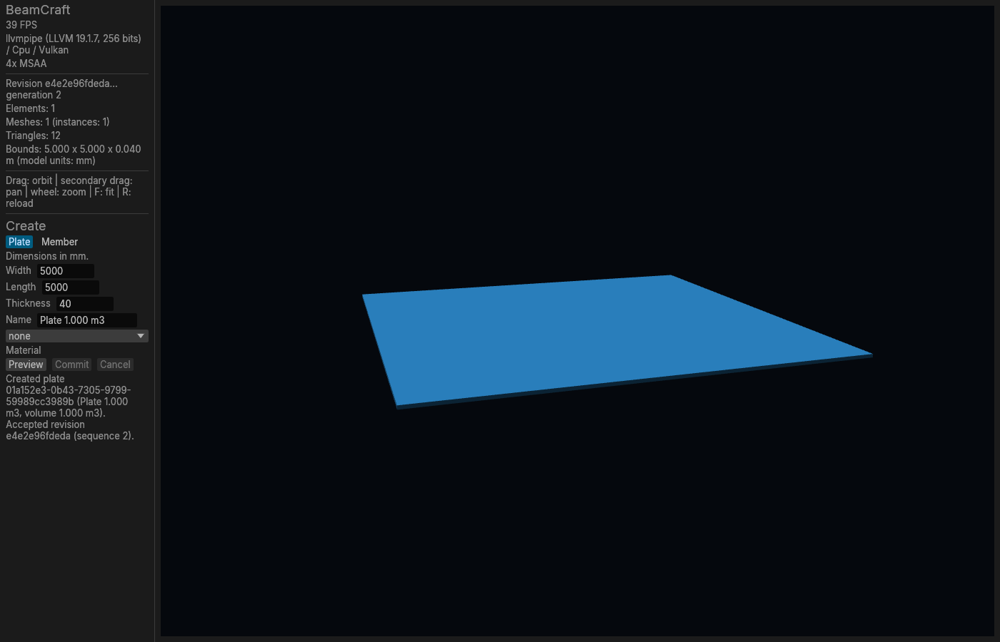
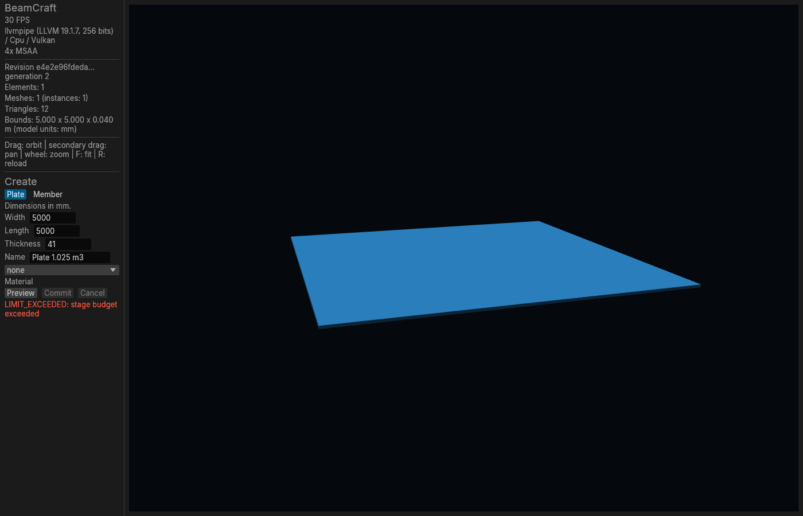
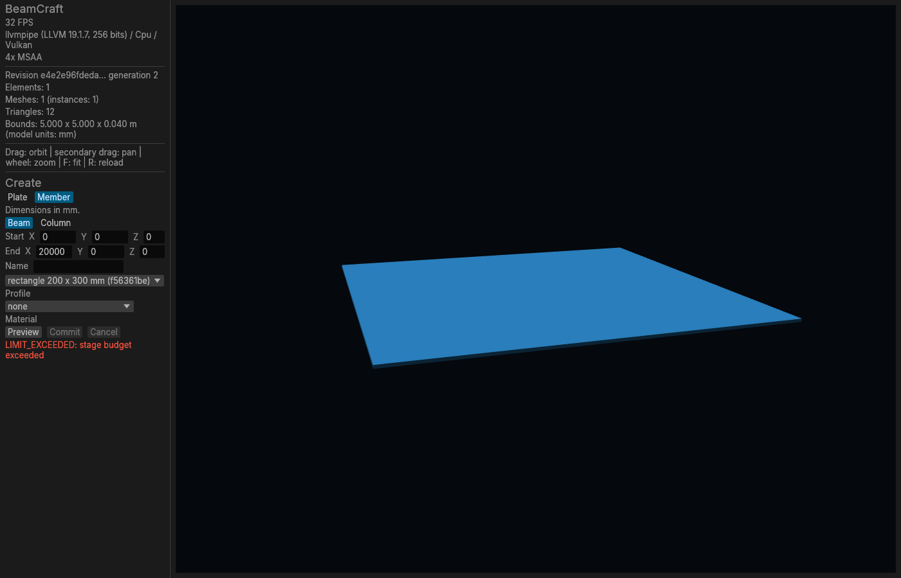
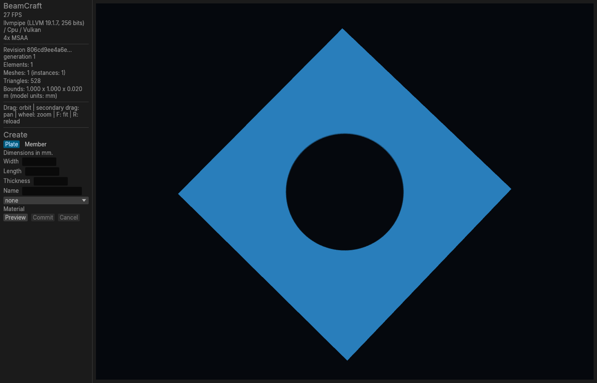
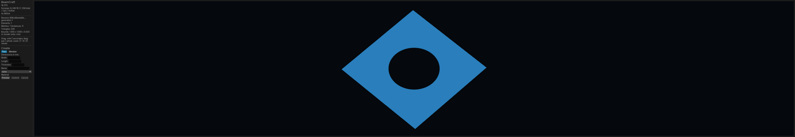
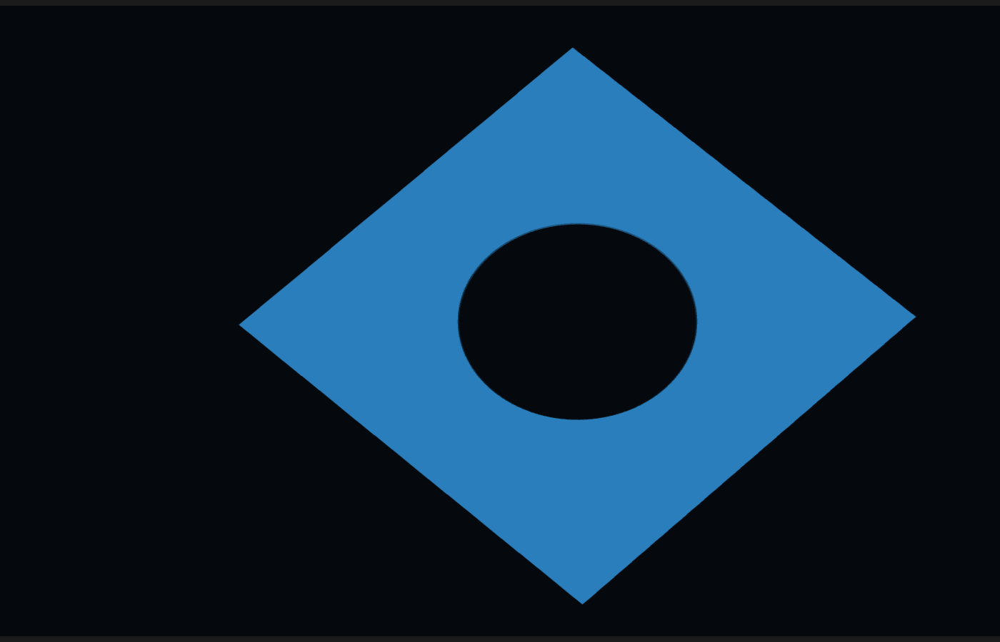
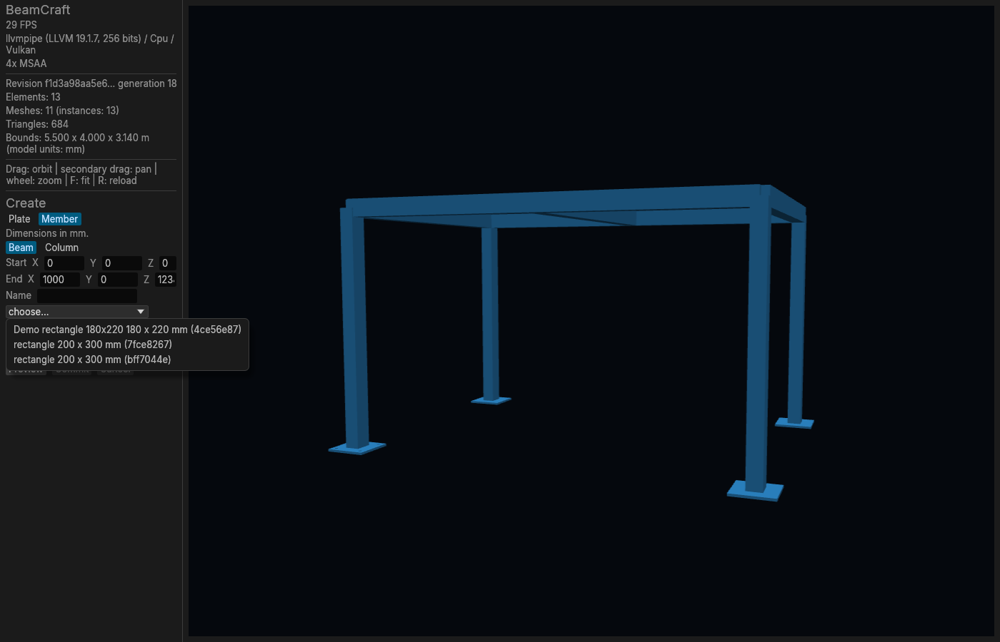
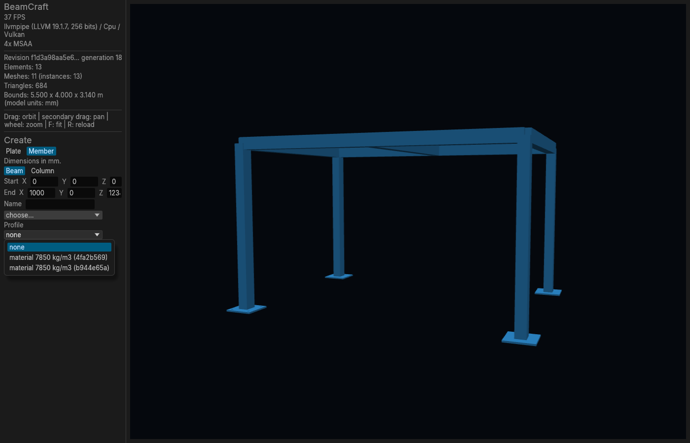
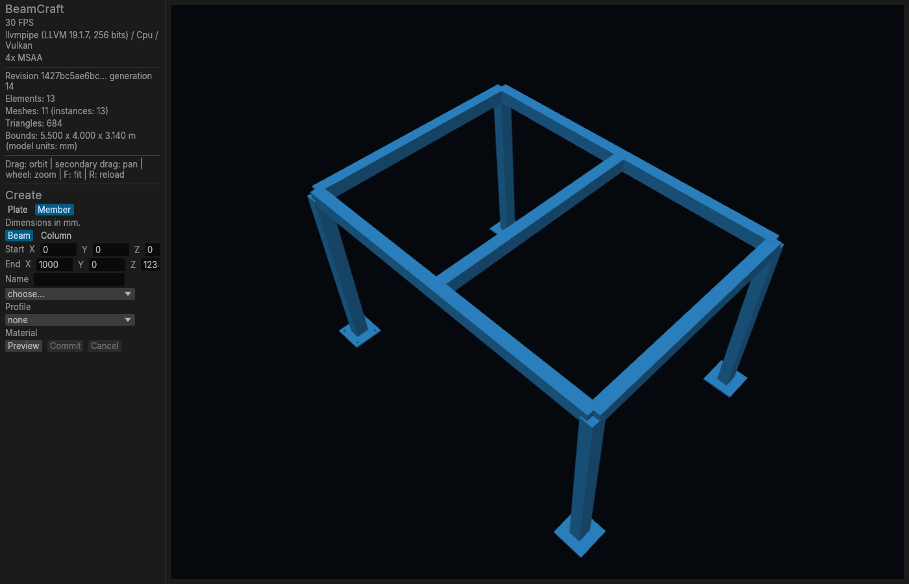
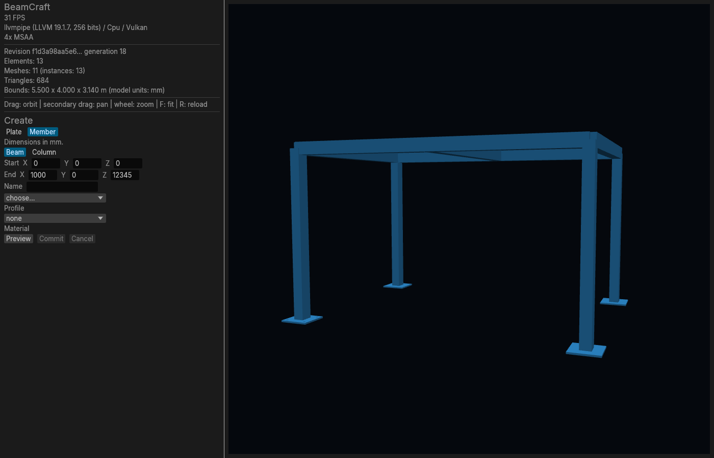

## Four visually confirmed bugs

The following behaviors were reproduced in the real native UI of **unmodified BeamCraft `11a213976ec592bf031f51b0bbdd35bcdcaf1776`**. All 11 screenshots are included below. The scene fixtures were created through BeamCraft's own CLI.

Environment: Debian 13 x86_64, Rust 1.99.1, development build, X11/Xvfb, llvmpipe LLVM 19.1.7 / CPU / Vulkan, 4x MSAA, 100% UI scale. These results establish the behavior of this commit on Linux; Windows and macOS were not tested.

Related build and smoke-test report: #18.

| Finding | Suggested priority | Visible result |
|---|---|---|
| 1 | P1 | A valid plate or member above 1 m³ cannot be created |
| 2 | P2 | Widening the window stretches a circular hole into an oval |
| 3 | P2 | Profile and material menus omit saved display names |
| 4 | P3 | The default member panel clips the End Z coordinate |

### 1. Elements with volume greater than 1 m³ are rejected

**Reproduction**

1. Create an empty absolute store directory and run `beamcraft define-profile --store /absolute/store --width 200 --height 300 --name Demo` to initialize a revision with a profile.
2. Open `beamcraft-ui --store /absolute/store`.
3. Select Plate. Enter Width `5000`, Length `5000`, Thickness `40`. Preview → Commit. Wait for completion.
4. Change Thickness to `41`. Preview → Commit. Wait for completion.
5. For an independent member case, select Member → Beam, Start `(0,0,0)`, End `(20000,0,0)`, and the `200 × 300 mm` rectangle profile. Preview → Commit.

**Observed:** the 40 mm plate succeeds, showing `Created plate`, `volume 1.000 m3` and `Elements: 1`. The 41 mm plate fails with the red message `LIMIT_EXCEEDED: stage budget exceeded`, and the element count remains 1. The 20 m member (1.2 m³) fails with the same message and does not appear in the scene.

**Expected:** these finite positive dimensions are within the project's geometric limits. A volume of 1.025 m³ should not be treated as exceeding the stage's data budget.

**Code explanation:** `crates/layer-engine/src/backend.rs:654` uses `number()` to reject every floating-point scalar above `1e9`, including `bim:volumeMm3`. `1e9 mm³` is exactly 1 m³. The quantity-specific validation in `crates/layer-engine/src/authored/validate.rs:1641` separately permits volume up to `1e30`. This explanation accompanies an actual UI reproduction.

40 mm control — successful creation:



41 mm — failed creation:



20 m beam — same failure:



### 2. Wide windows distort geometric proportions

**Fixture**

```sh
beamcraft create-plate --store /absolute/store --width 1000 --length 1000 --thickness 20 --hole-round 500,500,500 --hole-segments 128
beamcraft-ui --store /absolute/store
```

**Reproduction**

1. Use a `1400 × 900 px` window at 100% UI scale.
2. Orbit close to the top view by dragging upward with the primary mouse button until the pitch limit is reached.
3. Capture the view. Resize the window to `5200 × 900 px`, without changing the model, orbit or zoom.
4. Resize back to `1400 × 900 px` as a control.

**Observed:** the circular hole becomes horizontally stretched in the wide window. At native screenshot resolution, its dark opening changes from **275 × 273 px to 333 × 273 px**. Returning to the original window size restores the original proportions. Boundary rounding may differ by one pixel.

**Expected:** resizing a viewport preserves the model's proportions; a render-resolution limit may reduce sharpness but should not distort shapes.

**Code explanation:** `apps/beamcraft-ui/src/app.rs:564` clamps render-target width and height independently to 4096. The camera uses the clamped target's aspect ratio, but `Image` at line 570 stretches the result to the full viewport with a different aspect ratio.

Normal window:



Complete wide window:



Native-scale detail of the wide window (direct capture of a `1400 × 900 px` region at `(1900,0)`, without rescaling):



Control after returning to the normal size:


### 3. Profile and material menus omit saved display names

**Fixture commands**

```sh
beamcraft define-profile --store /absolute/store --width 200 --height 300 --name 'Roof beams'
beamcraft define-profile --store /absolute/store --width 200 --height 300 --name 'Floor beams'
beamcraft define-material --store /absolute/store --density 7850 --name 'Structural steel'
beamcraft define-material --store /absolute/store --density 7850 --name 'Test material'
```

**Reproduction:** open or reload this store in the UI using R outside a text field. Select Member and open the Profile and Material menus.

**Observed:** `Roof beams` and `Floor beams` appear as two `rectangle 200 x 300 mm` entries, differentiated only by hashes. `Structural steel` and `Test material` appear as two `material 7850 kg/m3` entries, again differentiated only by hashes. The entered names are absent. The original CLI replies with the persisted `display_name` values are included alongside the screenshots.

**Expected:** selection menus include the definitions' human-readable display names. Dimensions, density and hashes can supplement those names.

**Code explanation:** `apps/beamcraft-ui/src/tools.rs:450` and `:459` use `grade` and `designation` but ignore `display_name`. Workaround: select by manually matching hashes or use CLI name lookup (`--profile 'Roof beams'`, `--material 'Structural steel'`).

Profile menu:



Material menu:



### 4. Default member panel clips the End Z value

**Reproduction**

1. Open a fresh `1400 × 900 px` window at the default panel width. Select Member.
2. Enter `12345` in End Z and click the viewport to remove focus.
3. Capture the panel. Widen the sidebar to approximately 440 px using its divider, without editing the coordinate.

**Observed:** the default-width Z field displays only the beginning of the value and is noticeably narrower than X and Y. After widening the panel, the complete unchanged `12345` is readable.

**Expected:** the initial form provides enough space for ordinary millimetre coordinates so entered values can be checked. This is a lower-priority readability defect; manually widening the panel is a workaround.

**Code location:** `apps/beamcraft-ui/src/app.rs:389` lays out three axis labels and three coordinate fields in one horizontal row. Their combined width exceeds the initial panel width, shrinking the last field.

Default panel:



Same value after expanding the panel:



### Scope and provenance

The checks exercised create forms, Preview / Cancel / Commit, error display, definition menus, scene reload, camera navigation and window resizing. Documented pre-alpha omissions, including the lack of a geometry preview or GUI editing tools, are not counted as bugs. This is not an exhaustive audit or evidence that the same bugs occur on other platforms.

All screenshots are original captures, with synthetic geometry and no client data or commercial catalogue assets. Original screenshots and fixture descriptions are MPL-2.0; BeamCraft marks remain Apibim trademarks, and the Inter UI font remains OFL-1.1. This evidence branch contains documentation and captures; it does not change application code.
