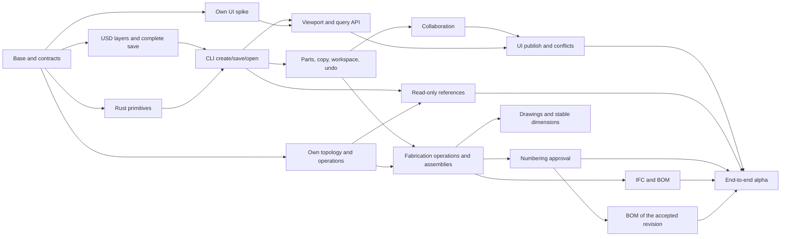

# Implementation plan

This folder is the project plan: where BeamCraft is going, in which order, and why. It replaces
the owner's local planning document (Russian, kept outside the repository until 2026-10-20).

| File | Contents |
|------|----------|
| [README.md](README.md) | Goal and boundaries, principles, gates and their order, what "done" means |
| [tasks.md](tasks.md) | Every task by ID (F04, U06, A03, ...): dependencies, result, acceptance, status |
| [decisions.md](decisions.md) | Owner decisions with dates, and the decisions still open |

[`ROADMAP.md`](../../ROADMAP.md) is the short public summary (stage, gate table, MVP, next work).
What a merged task actually does is in its note under [`docs/design/`](../design/); the
contracts it implements are under [`docs/contracts/`](../contracts/). The plan changes only in
docs-only pull requests.

## 1. Goal and boundaries

The first goal is a verified headless scenario: create a plate and a straight member, copy one,
change the copy, measure, save a complete USD revision and open it with ordinary OpenUSD. Personal
workspaces, read-only references, collaboration and the native UI follow. The next milestone adds
an agreed subset of fabrication operations, numbering, IFC export and a bill of materials.
Drawings have a milestone of their own.

The current target is the free single-user desktop MVP widened by the owner on 2026-10-21 (see
[decisions](decisions.md)): full manual steel modelling without automation, connection objects and
nested assemblies, user attributes and schedules, model tools, views, filters and
render modes, and drawings with drafting tools. The 2026-10-27 owner decision adds read-only IFC
reference loading and separate native steel IFC import through the kernel, including KM to KMD,
to the MVP. Their contracts and implementation remain open. Items (GLB and IFC mesh items), IFC
export, multi-client conflicts and parametric connections follow after the MVP.

The first alpha demonstrates the architecture on a limited subset. It does not mean that every
requirement is met, that any arbitrary USD file can be measured exactly, or that fabrication
export is complete. Readiness is decided by requirement coverage and evidence, not by the number
of closed tasks. Measured results keep their `unknown`, `stale` and `unsupported` states.

Fixed constraints:

- USD is the authoritative state; there is no second saved model format.
- Foreign references are read-only, overrides included.
- Identities are full UUIDv7 and full SHA-256; nothing is shortened.
- Own UI, no Omniverse Kit.
- Every user feature goes engine API → CLI command → end-to-end test; the UI follows the same path.
- Own code is MPL-2.0; the dependency, asset and `unsafe` rules of `AGENTS.md` hold.
- Synchronisation is opt-in, loopback-only and token-authenticated. No cloud and no IFC import by
  default.
- Written from scratch with our own logic: nothing from Tekla Structures or any other commercial
  detailing product (`AGENTS.md` §1–2).

## 2. Principles

### Stack

| Area | Choice | Condition |
|------|--------|-----------|
| Engineering core | Rust: BIM types, commands, checks, dependencies, transactions, copy-on-write, numbering | Logic never moves into the UI |
| Geometry | Own Rust kernel, f64, own primitives, extrusion, plane cuts and holes | No third-party kernel (truck, OCCT, Manifold, IFC-lite) as a backend or a source |
| USD | Pure-Rust `openusd` behind the BeamCraft layer-engine wrapper (F11, variant C) | The official SDK stays an explicit fallback and a test oracle only |
| UUID and digests | `uuid` with UUIDv7, `sha2` with full SHA-256 | No short IDs or hashes |
| Concurrency | Bounded pools for independent immutable work, after a sequential reference and measurements | A commit stays serialisable |
| UI | `wgpu` + `egui`/`eframe` | Own renderer and interaction; fonts and assets audited |
| Storage | USD files, immutable blobs, a journal, atomic publication of the root | No database or object store for the first product |
| IFC | Read-only reference loading and separate native steel import through the kernel (MVP scope approved 2026-10-27); existing own IFC4 writer (E01) | Input contracts and implementation remain open; export and I01-I03 mesh items remain after the MVP |
| Platforms | Desktop only: Windows, Linux, macOS | Only `geom`, `model` and `kernel` keep the WASM requirement, as a layering discipline |

### Own logic

The engineering and geometry kernel is our own, built from public mathematical sources and our own
fixtures, never from another kernel's source. Ready-made tools may serve as black-box oracles on
our inputs only, after their licence allows it; their results are checked against analytical
references and independent invariants.

### Fast application

- One owner of the live stage; stage edits and revision publication are coordinated.
  Parallel work runs on immutable inputs, not on arbitrary writes.
- Indexes and working snapshots in memory are derived from USD, never a second saved format.
- Commands are batched and changed IDs are passed incrementally. A rename or a camera change does
  not rebuild a shape; a material change recomputes mass and keeps the geometry blob.
- Meshes, instancing and GPU buffers are reused; camera navigation never reloads the stage. The GPU
  uses a local origin; engineering math stays f64.
- Bounds and metadata first, payloads on demand. An exact operation needs all its dependencies.
- Shared memory, direct FFI, compression, ECS and databases only for a measured bottleneck; never
  bypass `forbid(unsafe_code)` for an unproven gain.

Reference metrics: cold and warm open, peak RAM, p50/p95 of one edit and its rebuild, upload time,
frame time, selection latency, save and recovery time. Scenes: 2 elements for correctness,
1000 + 1000 for sync, 10 000 for the viewport, 100 000 as a stress test once the base is stable.
Each measurement states hardware, OS, build profile, versions and complexity (unique meshes and
triangles, not only the element count).

## 3. Gates

| Gate | Verified result | Main tasks |
|------|-----------------|------------|
| K0 | Current base, requirement map, contracts and fixtures | F01–F11 |
| K1 | The CLI creates and atomically saves a complete USD plate; a reader without BeamCraft opens it | U01–U07, G01–G02, P01 |
| K2 | Beam and column, quantities, independent copy, own workspace and local undo | P02–P08 |
| K3 | A supported foreign USD model, read-only, with separate measurements | R01–R03, G08 |
| K4 | Two offline clients: safe publish, rebase, conflict, retry and compensation | C01–C06 |
| K5 | Own UI uses the real commands; the saved result equals the CLI's | V01–V06 |
| K6 | Limited assemblies, cuts, holes, bolts, welds, approved numbering, IFC and BOM | A01–A09, E01–E03 |
| K7 | End-to-end alpha and a native packaging rehearsal | Q01–Q02 |
| K8 | Associative drawings, dimensions and marks, drafting, a published document version | D01–D08 |
| K9 | Full manual steel modelling | P12–P15, G12–G13, A10–A16 |
| K10 | Model tools, views, filters, render modes, selection and snap panels | T01–T04, V11–V17 |
| K11 | User attributes and schedules | I04, I05 |

K0 does not hold back mathematical or UI research: a blocker stops only the track that depends on
it. K3, K4 and K5 run partly in parallel; a gate is not a single global step. A research report
that proves an approach unsuitable also completes a research task, but never counts as a passed
production gate. The current gate status is in [`ROADMAP.md`](../../ROADMAP.md).

## 4. When a task is ready, and when it is done

A task can start when its hard dependencies are merged and verified on `master`, its contract
version and inputs are known, its write area does not overlap a running task, its acceptance checks
external behaviour with reproducible commands, the licence and policy questions it depends on are
closed, and it states what counts as a refusal, `unknown` and `unsupported`.

A large task is split into numbered slices (A07.1, A07.2, V05.1, ...) before it starts; the parent
ID stays the acceptance gate. A slice merged on `master` is "merged", marked experimental in its
design note. A task is **accepted** only when its acceptance criteria hold on the integrated
result: a file, a compile against a mock or a slice that covers part of the criteria does not
accept it. Acceptance tests are not changed to make an implementation pass; a wrong reference is
corrected by a separate contract amendment.

## 5. Verification

| Level | Required evidence |
|-------|-------------------|
| Domain and geometry | Correct inputs and outputs, invalid and degenerate inputs, bounded work; no input-derived panic |
| USD and schema | Real composition and explicit attributes without registering our schemas; a separate engineering validator |
| User feature | Engine API, CLI command and an end-to-end scenario; the UI follows the same path |
| Storage | Fault injection at each commit stage, draft recovery, old-or-new complete snapshot |
| References | Source bytes and foreign prims unchanged; overrides refused; measurements on our own objects |
| Copy-on-write | Distinct UUIDs; shape reuse until a shape edit; the original's inputs, shape and results unchanged |
| Sync | Independent edits, read dependencies, same-property conflict, delete/link, duplicate and retry, unsent draft kept |
| Performance | Release build, fixed scene and hardware, cold and warm data, thresholds after a baseline |
| Packaging | Audit of Rust and native dependencies and assets; the whole runtime, not only `cargo deny` |
| Native UI | Real engine snapshot, GPU and OS matrix, font policy, stale/conflict/unsupported states |

An independent reader opens saved USD with ordinary OpenUSD and checks authored values, geometry,
placement and units; it verifies the exchange, not the engineering formulas, which need analytical
or otherwise justified references. A check that could not run (missing SDK, target or GPU) is
reported as "not run", never as passed.

## 6. After the first queue

Each area below is an epic, split into small verifiable tasks before work starts.

| Area | Later work |
|------|------------|
| Parts and operations | Parametric and library connections, further part types |
| Catalogues and environments | Expand beyond the regional coverage decided on 2026-10-27; licensed bolt packs, firm/project/user resolution, aliases and migrations |
| Connections | Full bolt, hole and weld coverage, modifiers and feature dependencies, parametric joints |
| Measurement and checking | Complex closed meshes, clash detection, supported reference comparisons |
| UI | Large models, accessibility, further display options |
| Numbering | Further series, settings and control numbers |
| Drawings | Automatic dimensioning and layout rules beyond the first drawings, further output formats |
| Fabrication output | DSTV NC to a public specification; DXF and other formats after a scope and licence audit |
| Synchronisation | Soft leases with expiry, frequent autosync, access between computers, permissions by discipline |
| Exchange | Extend the separately specified MVP IFC reference/native steel-import scope; broader persistent source-change coordination needs its own decision |
| Presentation | 4D erection sequence as a separate layer; `GeomSubset` for face groups of FeatureIds |
